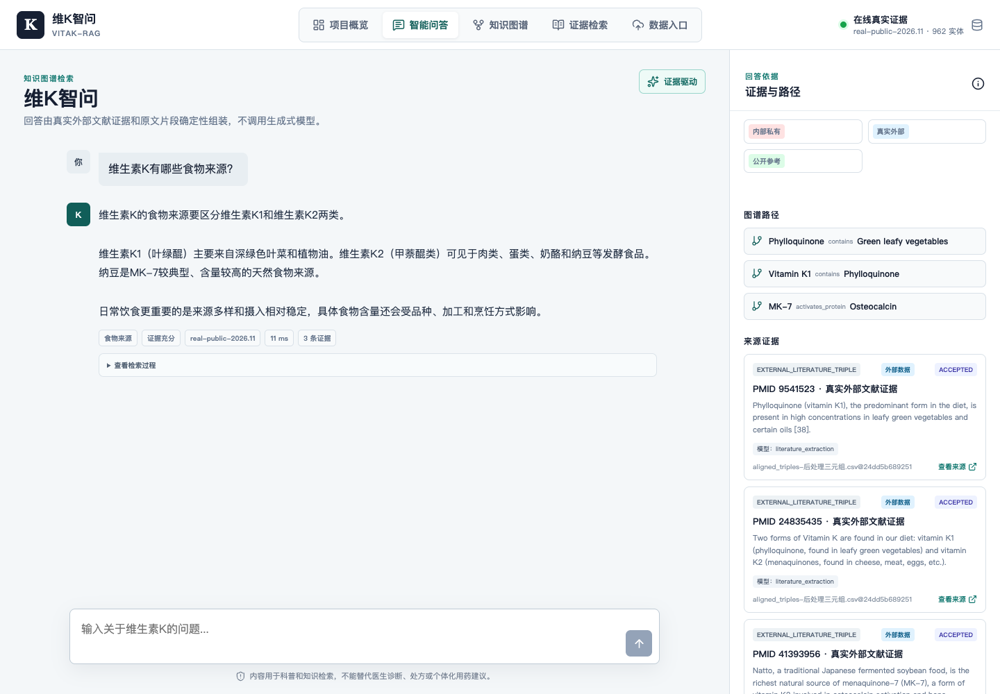
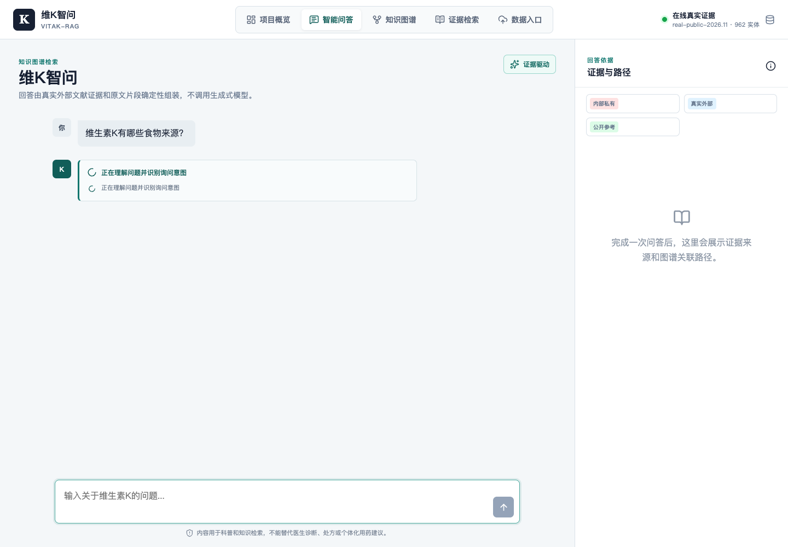

# 维K智问 VitaK-RAG

VitaK-RAG 是一个面向营养学、临床、药学和医学信息学研究人员的维生素 K 知识图谱检索与证据追溯原型。
系统使用 FastAPI、React、Kuzu、Chroma 和 SQLite。默认回答由经过版本化管理的实体关系、
证据路径和来源片段确定性组装；也支持默认关闭的 DeepSeek/OpenAI 兼容证据约束语言增强。
该模型只能解析问题和在既有 Citation 范围内改写表达，不是自由生成，也不能改变服务端数据范围。

预答辩版本采用双轨数据边界：

- **公网真实外部证据版**：GitHub Pages 使用 1,012 条已审核外部文献关系、3,123 条可问答的公开结构化关系，另含 1,200 条明确标记为“仅研究检索”的待审或暂定真实文献记录。
- **本地真实内外数据版**：FastAPI 后端激活 `vitak-real-2026.11` 私有快照，可同时检索 73,148 条外部证据和 248 条内部队列证据。内部数据仍标记为 `internal/private`。

## 在线演示

GitHub Pages 版本会把真实外部证据包加载到浏览器，直接运行确定性问答、图谱浏览和证据检索逻辑，无需安装环境：

<https://zhujinjiang0-blip.github.io/vitak-rag/>

在线演示不包含 FastAPI 文件入库和内部审核接口；这些能力仍通过仓库中的完整后端在本地运行。

系统默认进入智能问答；需要说明数据口径时，再进入“项目概览”查看真实三表的聚合审计结果、内外部来源说明和问答演示口径。

```text
structured_triples_final.csv   60,030 条
literature_triples_final.csv   13,118 条
internal_evidence_final.csv       248 条
合计                            73,396 条
```

公网只发布经筛选的真实外部文献和公开结构化语义关系。原始 CSV、内部证据、个体级数据和全量私有快照只保存在本机，不进入 GitHub、GitHub Pages 或飞书。完整演示流程见 [`docs/pre-defense-demo.md`](docs/pre-defense-demo.md)。





## 已实现能力

- 六领域维生素 K 属性图：生理代谢、食物营养、药物相互作用、临床疾病、检测评估、指南与 RCT。
- 公网真实外部证据包包含 1,012 条文献证据、3,123 条结构化问答关系、1,200 条研究检索证据、1,547 个实体和 5,335 条关系。
- 本地私有快照包含 73,396 条真实证据、36,638 个实体和 73,279 条关系，其中内部队列证据 248 条。
- 实体别名链接、规则意图识别、白名单图查询、1-2 跳路径检索和模板化回答。
- 药物问题按“作用机制、饮食影响、监测与安全边界”聚合真实证据，不再直接展示原始三元组。
- 问答先展示问题理解、实体匹配、证据检索和来源核对步骤，再按句子逐步呈现最终回答。
- 智能问答采用“项目 → 会话”两级结构，支持新建、重命名和删除项目，在项目内新建、搜索、重命名和切换会话。
- 每条回答均绑定 PMID 或内部统计来源定位；内部证据卡片显示分析语境、模型、样本量、效应量和 P 值。
- 证据不足时明确拒答，不使用模型补写；待审核和暂定证据不进入正式回答。
- 部分可答或证据不足的科研问题会写入未满足需求表，管理员可在数据治理页人工核查。
- 药物剂量、停药、诊断和紧急症状规则优先于普通知识检索。
- React 多页面应用：智能问答、项目概览、知识图谱、证据检索、内部研究、数据治理和数据入口。
- 内部研究页展示真实结果分布、按结局与模型分组的效应量点图，并支持 PNG/SVG 下载。
- 管理员数据治理页展示快照审计、输入 SHA-256、质量检查、版本差异、审核队列和操作日志。
- 文档入库、审核队列、版本快照、索引重建，以及普通 RAG 与 KG 混合检索两组评测命令行。
- 匿名临时会话、SSE 流式事件、localhost 内部 API 和本地离线演示数据。

## 技术结构

```text
backend/                 FastAPI、图谱查询、RAG 检索、数据管道和评测
frontend/                React + TypeScript + Vite 多页面应用
data/snapshots/          版本化运行快照，首次启动自动生成
data/eval/               评测题集与报告
scripts/
  bootstrap.sh           安装依赖并生成演示快照
  dev.sh                 同时启动前后端
  export-public-evidence.py  合并真实文献和结构化表，生成公网外部证据包
  visual-check.mjs       浏览器交互、截图和布局检查
  public-qa-smoke.mjs    公网真实证据问答冒烟测试
```

后端使用 Kuzu 存储属性图，Chroma 存储向量，SQLite FTS5 + Jieba 提供中文关键词检索。元数据和审核状态保存在同一快照的 SQLite 文件中。

## 可选大模型证据改写

本地全栈版支持可选的 OpenAI 兼容模型接口，默认关闭。当前本地 `.env` 已启用
`deepseek-chat` 并配置了非空 API Key，但 Key 不会在文档、日志或公网构建中展示。
启用后模型只做两件事：

1. 从问题中解析意图、候选实体及研究条件。
2. 将已经由图谱和原文检索得到的确定性答案改写为更自然的科研表达。

模型不能决定证据范围，也不会直接新增结论。每条生成 Claim 必须绑定确定性答案中的 Citation；
服务端会校验证据 ID、数字、实体支持度、阴性/关联/机制边界和因果措辞。任一关键校验失败时，
系统整体回退到原确定性回答，因此不配置模型时功能保持完整。

```bash
VITAK_RUNTIME_LLM_ENABLED=true
VITAK_RUNTIME_LLM_BASE_URL=https://api.deepseek.com/v1
VITAK_RUNTIME_LLM_API_KEY=your-local-secret
VITAK_RUNTIME_LLM_MODEL=deepseek-chat
```

API Key 只允许放在本地或受保护后端，不得写入前端、GitHub Pages、日志或版本库。
`GET /api/v1/health` 会返回模型是否已配置；问答响应中的 `generation` 字段会明确标记
`generated`、`fallback` 或 `disabled`。完整示例见 `.env.example`。

## 维生素K风险自查

问答页提供 7 步结构化风险自查，用于收集紧急症状、疾病背景、用药、特殊人群、
膳食和检测情况。该流程由后端确定性状态机执行，不调用大模型做诊断或补充决策：

- 活动性出血、黑便/呕血或急性神经系统症状会立即终止自查并提示就医。
- 肝胆疾病、吸收不良、抗凝药、新生儿、孕期、异常检测或不确定回答会升级为专业评估。
- 没有报告风险因素时只返回“信息不足”，不会输出“您不需要补充维生素K”。
- 免责声明明确说明该流程不能诊断缺乏，也不能确定个人剂量。

公网静态版使用相同问题和分支规则在浏览器内运行；本地全栈版通过
`/api/v1/triage/sessions` 系列接口执行，并绑定已审核的公开证据。

来源证据同时记录以下分类字段：

- `data_origin`：`internal`、`external`、`public` 或 `synthetic`。
- `data_owner`：资料所属团队、机构或公开来源方。
- `access_scope`：`private`、`controlled` 或 `public`。
- `source_classification`：`internal_rct`、`internal_database`、`guideline`、`review` 等细分类。

内部导入默认标记为 `internal/private`，外部文献和结构化资料标记为 `external/public`。旧演示快照仍保留 `synthetic` 兼容能力，但当前公网真实证据包不包含合成数据。

项目真实数据按以下三张表组织：

- 外部结构化／半结构化数据：60,030 条逻辑关系，统一标记为 `external/public`。
- 外部文献数据：564 项研究形成 13,118 条三元组，保留 PMID、原文证据句和等级，统一标记为 `external/public`。
- 内部数据：项目组 395 人前瞻性干预队列形成 248 条统计证据，统一标记为 `internal/private`。

完整字段和导入说明见 [`docs/data-sources.md`](docs/data-sources.md)。

## 本地启动

当前开发环境已激活包含真实外部和内部证据的私有快照，可以直接启动：

```bash
make api
make web
```

浏览器访问 `http://127.0.0.1:5173`，API 文档位于 `http://127.0.0.1:8000/docs`。

首次打开本地研究环境前，先创建管理员账号：

```bash
cd backend
../.venv/bin/python -m app.cli auth-init-admin admin '请替换为至少8位密码'
```

研究登录使用 HttpOnly、SameSite=Strict Cookie。当前问答页固定使用“领域知识”/外部公开证据，
不提供三模式切换框。后端问答接口仍保留 `domain`、`research`、`comparison` 三种模式并分别执行
服务端证据过滤；内部研究页保留内部证据筛选、统计详情和内部专题图谱能力。

内部研究和内外对照目前属于后端接口与内部研究页能力，未在问答页暴露为可选模式。

本地数据入口位于 `http://127.0.0.1:5173/#/import`：

- 页面支持上传 42 列统一三元组表，按每行 `source_type` 自动标记内外部来源。
- `internal` 映射为内部/私有；`literature` 和 `structured` 映射为外部/公开。
- GitHub Pages 在线版是只读演示，文件上传必须在本地全栈模式运行。

也可以在一个终端启动前后端：

```bash
./scripts/dev.sh
```

如果 `8000` 已被其他本地演示占用，可同时指定后端和前端端口：

```bash
VITAK_API_PORT=8001 VITAK_WEB_PORT=5173 ./scripts/dev.sh
```

此环境原先没有 Node、Python 3.12 或 Docker。脚本默认使用 Codex 随附运行时；在其他机器上可通过 `PYTHON_BIN`、`PNPM_BIN` 指定本机路径。

完整重新安装：

```bash
./scripts/bootstrap.sh
```

## 常用命令

```bash
cd backend

# 创建或恢复旧演示快照
../.venv/bin/python -m app.cli seed-demo

# 查看、校验、激活和回滚快照
../.venv/bin/python -m app.cli snapshot-list
../.venv/bin/python -m app.cli snapshot-validate vitak-real-2026.11
../.venv/bin/python -m app.cli snapshot-activate vitak-real-2026.11

# 从基础快照派生固定研究版本
../.venv/bin/python -m app.cli snapshot-clone \
  vitak-real-2026.11 vitak-research-2026.11-t02

# 账号、停用和会话撤销
../.venv/bin/python -m app.cli auth-create-user researcher '请替换为至少8位密码'
../.venv/bin/python -m app.cli auth-disable researcher
../.venv/bin/python -m app.cli auth-enable researcher
../.venv/bin/python -m app.cli auth-reset-password researcher '新密码至少8位'
../.venv/bin/python -m app.cli auth-revoke researcher
../.venv/bin/python -m app.cli auth-list
../.venv/bin/python -m app.cli auth-audit

# 导入外部文献 aligned_triples.csv
../.venv/bin/python -m app.cli import-external-triples path/to/aligned_triples.csv

# 预检三张 42 列真实证据表，不写入数据库
../.venv/bin/python -m app.cli audit-evidence-tables \
  path/to/internal_evidence_final.csv \
  path/to/literature_triples_final.csv \
  path/to/structured_triples_final.csv

# 将三张表写入独立私有快照
../.venv/bin/python -m app.cli import-evidence-tables \
  --version vitak-real-next \
  path/to/internal_evidence_final.csv \
  path/to/literature_triples_final.csv \
  path/to/structured_triples_final.csv

# 合并真实文献和结构化表，生成可公开的静态外部证据包
../.venv/bin/python ../scripts/export-public-evidence.py \
  path/to/literature_triples_final.csv \
  path/to/structured_triples_final.csv

# 导入文本型 PDF、DOCX、TXT、Markdown、JSON、XML、HTML、CSV 或 XLSX
../.venv/bin/python -m app.cli ingest path/to/document.pdf --title "材料名称"

# 使用云模型产生候选关系，但不会直接写入图谱
../.venv/bin/python -m app.cli ingest path/to/document.pdf --use-llm

# 导出并审核候选关系
../.venv/bin/python -m app.cli review-export
../.venv/bin/python -m app.cli review-apply --decision approve --ids CANDIDATE_ID

# 重建当前版本的向量索引
../.venv/bin/python -m app.cli rebuild-index

# 生成 80 道题并运行评测
../.venv/bin/python -m app.cli generate-eval
../.venv/bin/python -m app.cli evaluate
```

Kuzu 使用文件锁。运行 CLI 时若 API 正在访问同一快照，可能提示无法加锁。此时应使用内部 API 完成导入，或先停止 API 再运行 CLI。

## 问答处理流程

1. 规范化问题并匹配实体名称、ID 和别名。
2. 通过确定性规则识别食物来源、相互作用、缺乏风险、检测指标等意图。
3. 从 Kuzu 查询白名单关系，最多扩展两跳路径。
4. 从 SQLite FTS5 和 Chroma 召回来源片段。
5. 真实数据快照优先使用实体别名扩展后的 FTS 和 Chroma 证据检索，并按 `answer_eligible` 过滤待审核记录。
6. 根据来源、证据等级、抽取置信度和路径长度组装回答。
7. 如果证据不足，返回拒答和相关实体，不生成未经知识库支持的内容。

公共接口：

- `POST /api/v1/qa/query`
- `POST /api/v1/qa/stream`
- `POST /api/v1/auth/login`
- `POST /api/v1/auth/logout`
- `GET /api/v1/auth/me`
- `GET /api/v1/auth/session`
- `GET /api/v1/search?q=...`
- `GET /api/v1/evidence/{id}`
- `GET /api/v1/graph/search?q=...`
- `POST /api/v1/graph/subgraph`
- `GET /api/v1/health`

研究会话接口：

- `GET /api/v1/research/overview`
- `GET /api/v1/research/facets`
- `GET /api/v1/research/evidence`
- `GET /api/v1/research/insights`

反馈和治理接口：

- `POST /api/v1/feedback/unmet`
- `GET /internal/v1/governance/active`
- `GET /internal/v1/governance/snapshots/{version}`
- `GET /internal/v1/governance/diff`
- `GET /internal/v1/unmet-needs`
- `GET /internal/v1/audit-logs`

内部检索、研究问答和对照问答要求有效研究会话。`/internal/v1/*` 的数据治理、导入和快照管理接口只允许本地管理员会话。

研究集合口径为全量 248 条、核心 48 条、情境化 160 条，核心与情境化交集 9 条。三个数字允许重叠，不能相加为 456。内部证据统一返回 `internal/private` 标记。

## 入库与审核

入库会从当前快照复制出新的版本目录，解析文档、切分片段、建立来源证据并产生候选关系。内部导入默认使用 `data_origin=internal`、`access_scope=private`，可通过 CLI 参数覆盖。候选关系进入 SQLite 审核队列，只有执行 `review-apply --decision approve` 后才写入图谱。

离线结构化抽取默认使用阿里云百炼 Qwen，可通过 `.env` 切换任意 OpenAI 兼容接口。
可选的运行时 DeepSeek/OpenAI 兼容模型只负责问题结构解析和证据约束语言改写；不配置模型时
系统完整回退确定性回答。

扫描件首版只给出“待 OCR”警告，不会把空文本当作成功解析。

## 评测结果

旧版 124 实体演示快照上运行 80 道分层问题的历史三组结果位于 `data/eval/report.json`。该文件仅作历史记录，不能与 V2 两组实验混算：

| 方法 | Recall@5 | MRR@10 | nDCG@10 | 路径命中率 | P95 |
| --- | ---: | ---: | ---: | ---: | ---: |
| 纯向量检索 | 0.016 | 0.028 | 0.018 | 0.000 | 6.5 ms |
| 纯图谱检索 | 0.762 | 0.734 | 0.764 | 0.813 | 24.7 ms |
| KG混合检索 | 0.887 | 0.859 | 0.889 | 0.938 | 30.4 ms |

无证据问题拒答准确率为 1.0。该结果只能证明检索与评测管线可运行，新的真实证据问答仍需继续扩充人工标注题集。

V2 自动评测只保留两组：普通 RAG（关键词+语义）与 KG 混合。CLI 默认输出路径为
`data/eval/report-two-group.json`；当前开发运行另保留日期化结果
`data/eval/report-two-group-2026-11-25.json`：

```bash
cd backend
../.venv/bin/python -m app.cli evaluate
```

当前 80 题开发运行中，普通 RAG Recall@5 为 0.5657，KG 混合为 0.5500；
KG 多跳路径命中率为 0.7，无证据/安全题准确率为 1.0。该结果仍需纳入最终冻结并由科研负责人复核。

完整需求状态和待外部输入事项见 [`docs/prd-v2-implementation-matrix.md`](docs/prd-v2-implementation-matrix.md)。
当前 PRD 管理口径为：`26 已完成`、`13 部分完成`、`2 待外部输入`、`2 不新增`。

## 测试与界面验收

```bash
make test
make lint
make build
VITAK_CHECK_INTERNAL=true \
VITAK_RESEARCH_USER=admin \
VITAK_RESEARCH_PASSWORD='本地测试密码' \
node scripts/visual-check.mjs
```

浏览器验收覆盖登录、领域知识问答、内部研究页与筛选、数据治理、图谱局部范围、证据检索和移动端布局，
并检查控制台错误、横向溢出和截图非空。问答页三模式切换框已移除，不再作为前端验收项。

## 当前边界

- 公开问答不要求登录；内部研究与数据治理需要受控会话，当前未实现按项目、集合和操作粒度的完整授权矩阵。
- 问答页固定领域知识模式；内部研究和内外对照仅保留后端接口与内部研究页能力，面向用户的三模式入口仍属部分完成。
- 公网只提供 GitHub Pages 只读静态演示，FastAPI 后端不暴露到公网。
- 无扫描件 OCR 和复杂 PDF 版面还原。
- 文献抽取关系仍需持续进行谓词归一、人工复核和真实问题覆盖评测。
- 审核匹配表、OWL、真实 CI/单位和科研负责人签认尚未全部提供，系统会明确标记这些缺项。
- 所有内容仅用于知识检索和科普演示，不能替代医生诊断、处方或个体化用药建议。

当前结论：预答辩可以在限定口径下使用；最终科研交付尚未完成，不能表述为科研签认或临床验证完成。
